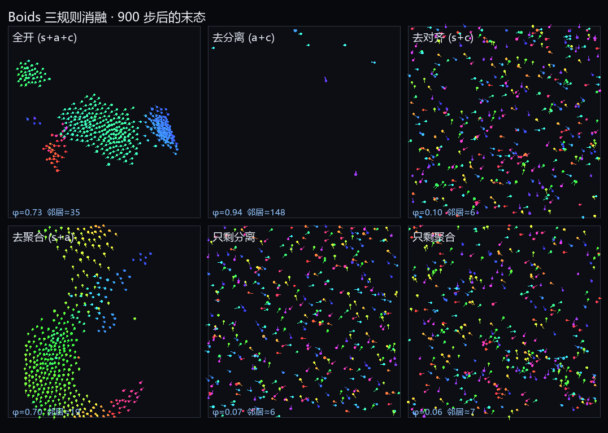
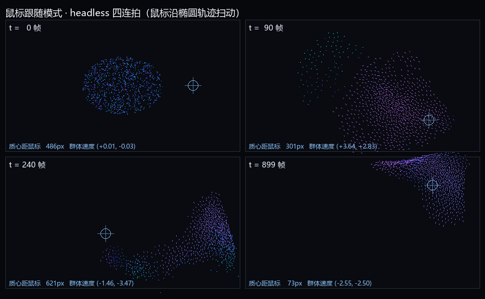

# Boids · 鸟群效应

Boids（Craig Reynolds, 1986）的三条规则实现 + 一份跟着鼠标飞的交互式动画。

**在线试玩** → <https://kyyyyyy638-hue.github.io/boids-mouse-flock/>

没有任何鸟知道整个群体的样子，它们只知道「自己 + 视野里那几个邻居」。整群的形状、涡旋、分裂与重组，全部从三行加法里长出来。



## 快速开始

**看动画**：双击 `mouse-flock.html`，或拖进浏览器。单文件、零依赖、不需要服务器。

**跑实验**：

```bash
pip install numpy pillow
python boids.py        # 三规则消融实验，打印极化度表
python render.py       # 生成 docs/boids_ablation.png
```

## 三条规则

| 规则 | 看谁 | 干什么 | 公式 |
|---|---|---|---|
| **分离** Separation | 最近的一小圈（半径小） | 远离，越近推得越狠 | $\vec s_i=\sum_{j\in N_i^s}\dfrac{\vec p_i-\vec p_j}{\lVert\vec p_i-\vec p_j\rVert^2}$ |
| **对齐** Alignment | 视野内全部邻居 | 转向邻居的平均朝向 | $\vec a_i=\dfrac{1}{\lvert N_i^a\rvert}\sum_{j\in N_i^a}\vec v_j-\vec v_i$ |
| **聚合** Cohesion | 视野内全部邻居 | 转向邻居的质心 | $\vec c_i=\dfrac{1}{\lvert N_i^c\rvert}\sum_{j\in N_i^c}\vec p_j-\vec p_i$ |

合起来一帧只做一次加法、一次限幅：

$$\vec v_i \leftarrow \mathrm{clamp}\Big(\vec v_i + w_s\hat u(\vec s_i)+w_a\hat u(\vec a_i)+w_c\hat u(\vec c_i)\Big),\qquad \vec p_i\leftarrow \vec p_i+\vec v_i$$

$\hat u(\cdot)$ 是单位化。方向比大小重要——否则离得最远的那条规则会独占全部权重。

还有两条隐含规则，缺了会立刻出问题：

- **边界**：贴墙时加一个向内的力，否则鸟群糊在墙上。
- **速度下界**：`v_min > 0` 是必需的。速度归零的鸟会原地堆积成一坨。

## 尺度关系决定形态

```
r_sep  <  r_align ≈ r_coh          # 分离半径必须最小
w_sep  >  w_align ≈ w_coh          # 分离权重必须最大
v_min  >  0                        # 不允许停下来
```

`r_sep` 调到和 `r_align` 一样大，整群自动散开；`w_sep` 归零，整群塌成一个点。

## 交付物一：`mouse-flock.html`



| 操作 | 效果 |
|---|---|
| 移动鼠标 | 鸟群追着指针飞，靠近后绕着你盘旋 |
| 按住左键 | 「跟随」切「惊飞」，整群炸开；松开自动回来 |
| 空格 / R / H / C | 暂停 / 重排 / 收起面板 / 换配色 |

面板六个滑块实时生效：数量、分离、对齐、聚合、跟随、盘旋、视野。

### 鼠标力：为什么要加切向分量

只给一个「朝鼠标飞奔」的力，整群会撞成一坨硬球。所以鼠标力是**径向 + 切向**的合成：

```js
var f = 1 / (1 + (dist / 650) * (dist / 650));   // 远距离衰减
var ux = dx / dist, uy = dy / dist;              // 径向：朝鼠标
var tx = -uy,       ty = ux;                     // 切向：垂直
var orbF = orbit * f;                            // 只在靠近时才变强
var g = normalize(ux + orbF * tx, uy + orbF * ty);
fx += wFollow * f * g.x;
```

`orbit * f` 是关键：**远的时候全速直冲，近的时候切向接管**。所以拖到哪它追到哪，又不会糊在光标上，而是绕着打旋。

### 配色

三套，按 `C` 切换。默认按速度着色（慢=青，快=亮紫），方向只做 `sin(ang)` 微调制。

| 模式 | 逻辑 | ±π 接缝色差 |
|---|---|---|
| 速度（默认） | 色相跟速度，方向微调 | 0.0° |
| 单色流光 | 固定青蓝，亮度表速度 | 0.0° |
| 方向色环 | 完整 360° 色环，首尾闭合 | 9°（环上相邻） |

### 默认参数

| 参数 | 值 | 说明 |
|---|---|---|
| `count` | 900 | 个体数 |
| `rSep` | 26 px | 分离半径 |
| `rAli` / `rCoh` | 70 px | 视野半径 |
| `wSep` / `wAli` / `wCoh` | 2.0 / 1.0 / 0.6 | 三规则权重 |
| `wFollow` | 1.0 | 鼠标引力 |
| `orbit` | 0.75 | 切向分量比例 |
| `vMin` / `vMax` | 1.6 / 5.4 px/帧 | 速度区间 |
| `maxForce` | 0.26 | 每帧最大转向量 |

## 交付物二：`boids.py` 消融实验

400 个体、900 步、θ 为极化度（`|Σv| / Σ|v|`，0=乱飞，1=全体同向）：

| 配置 | φ 末态 | 平均邻居 | 形态 |
|---|---|---|---|
| 全开 | 0.73 | 35 | 分裂成几团流动的子群 |
| 去分离 | 0.94 | **148** | 全叠成一坨（φ 更高但结构死了） |
| 去对齐 | 0.10 | 6 | 散沙，聚合只让人靠近、不让人同向 |
| 去聚合 | 0.70 | 19 | 拉成一条带、一片墙 |
| 只剩分离 | 0.07 | 6 | 均匀气体 |
| 只剩聚合 | 0.06 | 7 | 塌成一团打转 |

结论：**分离撑结构，对齐出极化，聚合给整体性**。去掉任何一个都退化成一个可辨认的死状态。

注意「全开」的 φ 只有 0.73，而「去分离」反而 0.94——真实鸟群是**局部高度有序但整体不完全同向**的临界状态，不该把 φ 最大化当目标。

## 两个踩过的坑

**1. 色相在 ±π 处断裂**

一开始直接拿 `atan2(vy, vx)` 映射色相：

```js
var band = ((ang / (2 * Math.PI) + 0.5) * BANDS) | 0;   // ✗
```

`-π` 和 `+π` 是**同一个朝向**（正左），却落在色环两端：实测两侧色相 178.0° vs 338.9°，差 **160.9°**。整群往左飞时方向角在 ±π 附近抖动，于是整片颜色青↔粉乱闪。

修法是把色相主体交给速度（标量，不会周期性跳变），方向只用 `sin(ang)` 微调制——`sin` 跨 ±π 连续且导数为 0，接缝色差降到 0.04°。

**2. `spawn()` 早于 `resize()`**

面板绑定时会立刻 `apply()` 一次，顺带调 `spawn()`。但如果这段初始化写在 `resize()` 之前，模块内的 `W/H` 还是 0，**所有鸟都出生在 `(0,0)` 一个点上**。现在启动顺序是 `resize() → spawn() → bind()`。

## 校验脚本

```bash
node test-headless.js      # 数值回归：稳定、收敛到鼠标、惊飞反向
node color-check.js        # 配色连续性：扫一圈朝向查接缝跳色
node export-snapshot.js    # 从 HTML 导出四帧快照 → snapshot.json
python render_follow.py    # 快照渲染成 docs/mouse-follow.png
```

`test-headless.js` 和 `color-check.js` 都用 `vm` + mock canvas 跑 HTML 里的**真实代码**，不是复制一份算法出来测。

最近一次实测（1600×900，900 只）：

```
单步耗时            2.68 ms/帧
全程质心距鼠标均值  227.7 px
全程最近个体距鼠标  0.3 px
NaN / 越界          0 / 0
惊飞 120 帧         244.6 → 714.5 px（方向正确）
```

## 目录结构

```
.
├── mouse-flock.html      # 交互式动画，单文件零依赖
├── boids.py              # Boids 引擎 + 三规则消融实验
├── render.py             # 消融对照图（Pillow）
├── render_follow.py      # 跟随四连拍（Pillow）
├── export-snapshot.js    # 从 HTML 导出仿真快照
├── test-headless.js      # headless 数值回归
├── color-check.js        # 配色连续性校验
└── docs/                 # 生成的图 + Pages 部署副本
```

## 依赖

- 动画：任意现代浏览器
- Python 部分：`numpy`、`pillow`（不出图只要 numpy）
- Node 部分：Node 18+，无第三方包

渲染脚本用 Pillow 而不是 matplotlib，是为了不引入重依赖、且能精确控制 CJK 字体。

## 生物学补丁

写代码时会想「照着真实鸟群调参」，但那三条规则和真实鸟群有差距：

- **拓扑 ≠ 固定距离**。Ballerini 等（2008，椋鸟）发现椋鸟实际是和**最近 6–7 只**互动，不是和半径内的所有鸟。拓扑邻居下密度变化不会散群，固定距离会。把 `dist < r_align` 换成「取第 k 近邻」会更像真的。
- **Couzin 三区模型**：把「分离/对齐/聚合」改成同心三环——repulsion 区只排斥、alignment 区只对齐、attraction 区只吸引。形态更接近鱼群鸟群，而且能分析相变。
- **Vicsek 模型**是它的简化极端：去掉聚合只留对齐 + 噪声，噪声一低就发生有序—无序**相变**，粒子数增多时临界噪声趋于非零。自驱动粒子的标准模型。
- **异质性**：少数速度快、信息量大的个体往往决定整群决策方向，这是几条简单规则能支撑迁徙、躲避捕食者的原因之一。

## License

MIT
